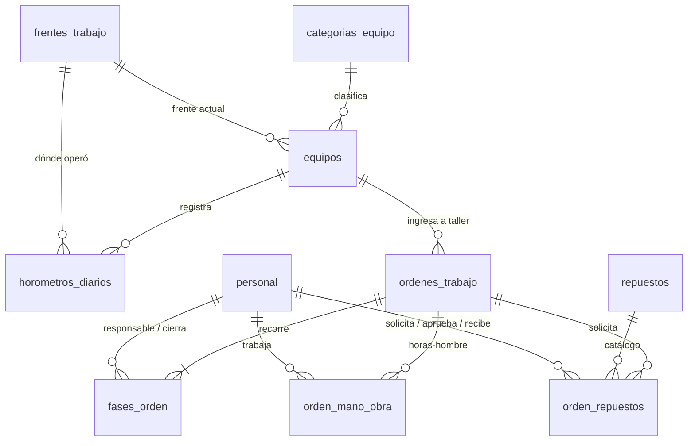

# Esquema de base de datos

PostgreSQL 14+ (la app trae PostgreSQL 18 embebido). Fuente de verdad:
[`src/main/db/migraciones/001_inicial.sql`](../src/main/db/migraciones/001_inicial.sql).
Las migraciones se aplican solas al arrancar (tabla `schema_migraciones`, protegidas con
`pg_advisory_xact_lock` para que dos PCs no migren a la vez contra un servidor compartido).

Los valores enumerados son `VARCHAR + CHECK`, no `CREATE TYPE`, para poder ampliarlos con
un `ALTER TABLE ... DROP/ADD CONSTRAINT` simple.

## Diagrama



## Tablas

### `equipos`
| Columna | Tipo | Notas |
|---|---|---|
| `codigo_interno` | varchar(30) UNIQUE | En mayúsculas (lo normaliza la validación). |
| `numero_serie` | varchar(60) UNIQUE | |
| `marca`, `modelo` | varchar(60) | |
| `anio` | int | 1950–2100, opcional. |
| `categoria_id` | FK `categorias_equipo` | Excavadora, camión minero, cargador… (catálogo editable). |
| `horometro_actual` | numeric(10,1) ≥ 0 | Sube solo con `horometros_diarios` y con el horómetro de ingreso/salida de una OT (`GREATEST`). |
| `estado` | `operativo` · `en_mantenimiento` · `en_reparacion` · `fuera_servicio` | Ver *Estado derivado*. |
| `frente_actual_id` | FK `frentes_trabajo` | Sigue al registro de horómetro más reciente. |

**Estado derivado** (`servicios/estadoEquipo.ts`): con alguna OT abierta y `equipo_detenido`:
correctiva/emergencia → `en_reparacion`; solo preventivas → `en_mantenimiento`. Sin OT abiertas
vuelve a `operativo`. Solo `operativo ↔ fuera_servicio` se cambia a mano.

### `horometros_diarios`
Uso diario. Varias filas por día (turnos/frentes) permitidas.

| Columna | Notas |
|---|---|
| `fecha` | No futura. |
| `horometro_inicial`, `horometro_final` | `final ≥ inicial`, diferencia ≤ 24 h (CHECK). |
| `horas_trabajadas` | **Columna generada** = final − inicial. |
| `frente_id`, `actividad`, `operador` | Dónde y en qué operó. |

Regla en el servicio (con `SELECT … FOR UPDATE` sobre el equipo): las lecturas no pueden
solaparse y deben crecer con la fecha. Solo se puede borrar la lectura más reciente de cada equipo.

### `ordenes_trabajo`
| Columna | Notas |
|---|---|
| `folio` | `OT-AAAA-NNNNN`, atómico vía `secuencias` (`INSERT … ON CONFLICT DO UPDATE … RETURNING`). |
| `tipo` | `preventivo` · `correctivo` · `emergencia`. |
| `prioridad` | `baja` · `media` · `alta` · `critica`. |
| `descripcion` | Síntoma/motivo (mín. 10 caracteres). |
| `sistema_afectado` | motor, hidráulico, tren de rodaje… Base del análisis de fallas recurrentes. |
| `equipo_detenido` | Si cuenta para downtime y cambia el estado del equipo. |
| `diagnostico`, `causa_raiz`, `trabajo_realizado`, `resultado_pruebas` | Se exigen al salir de la fase correspondiente. |
| `horometro_ingreso`, `horometro_salida` | `salida ≥ ingreso` (CHECK). |
| `recibido_por` | Quien recibe en la liberación (operaciones). |
| `fase_actual` | Una de las 7 fases. |
| `estado` | `abierta` · `cerrada` · `cancelada`. |
| `fecha_apertura`, `fecha_cierre` | CHECK: abierta ⇔ sin cierre; cierre ≥ apertura; `cerrada` ⇒ `fase_actual = liberacion`. |

### `fases_orden` — trazabilidad
Una fila por **visita** a una fase (una OT puede volver a una fase anterior).

| Columna | Notas |
|---|---|
| `fase`, `secuencia` | `UNIQUE(orden_id, secuencia)`. |
| `inicio`, `responsable_id` | Fecha/hora y responsable al abrir la fase. |
| `fin`, `cerrado_por_id` | Fecha/hora y quien firma la transición. CHECK: ambos nulos o ambos presentes. |
| `observaciones` | Notas de cierre. |
| `omitida` | Procura sin repuestos (inicio = fin). |
| `motivo_retorno` | Si la visita es un retroceso (retrabajo). |

Índice único parcial `uq_fase_abierta (orden_id) WHERE fin IS NULL`: **a lo sumo una fase
abierta por orden**, garantizado por la base de datos.

### `repuestos` (catálogo) y `orden_repuestos` (procura)
`orden_repuestos`: `cantidad > 0`, `costo_unitario ≥ 0`, `costo_total` generado,
`proveedor`, `numero_requisicion`, y el ciclo con fecha y responsable de cada paso:

```
solicitado ──aprobar──▶ aprobado ──recibir──▶ recibido
     └──────rechazar──────┴──▶ rechazado
```

### `orden_mano_obra`
Horas-hombre por técnico **imputadas a una fase**. `costo_hora` es una copia del costo del
técnico al momento del registro (cambios posteriores de tarifa no alteran costos históricos).

### `personal`, `frentes_trabajo`, `categorias_equipo`
Catálogos con `activo` (los inactivos no se ofrecen en selectores pero conservan historial).
Sin login: el responsable de cada transición se elige de `personal`.

## Máquina de estados de las fases

Definida una sola vez en [`src/shared/dominio.ts`](../src/shared/dominio.ts) y aplicada en el
servidor (`servicios/ordenes.ts → transicionar`) y en la UI (botones permitidos).

```
1 Recepción → 2 Inspección → 3 Diagnóstico → 4 Procura → 5 Ejecución → 6 Pruebas → 7 Liberación
                                   └────── omitir procura ─────▲
Retornos (con motivo obligatorio):  Procura → Diagnóstico
                                    Ejecución → Diagnóstico | Procura
                                    Pruebas → Diagnóstico | Procura | Ejecución
```

| Regla | Dónde |
|---|---|
| Solo se avanza a la fase siguiente. | `validarTransicion` |
| Salir de Diagnóstico exige `diagnostico`; de Ejecución, `trabajo_realizado`; de Pruebas, `resultado_pruebas`. | `REQUISITO_SALIDA` |
| Entrar a Ejecución o Pruebas exige 0 repuestos en `solicitado`/`aprobado`. | `transicionar` |
| La fecha/hora de la transición no puede ser anterior al inicio de la fase abierta ni futura. | `transicionar` + zod |
| Liberación exige `recibido_por`; cierra la OT (`estado = cerrada`, `fecha_cierre`) y recalcula el estado del equipo. | `transicionar` |
| Cancelar: cierra la fase abierta, rechaza repuestos pendientes, recalcula estado del equipo. | `cancelar` |
| Una OT cerrada o cancelada no admite cambios. | `bloquearOrden` |

Todas las operaciones corren en transacción con `SELECT … FOR UPDATE` sobre la orden.

## Métricas (vistas)

**`v_orden_totales`** por OT:
- `costo_repuestos` = Σ `costo_total` de repuestos no rechazados.
- `costo_mano_obra`, `horas_hombre` = Σ de `orden_mano_obra`.
- `downtime_horas` = (cierre o ahora) − apertura, si `equipo_detenido`.
- `horas_reparacion` = Σ duración de las visitas a **Ejecución + Pruebas** (sin esperas de procura).

**`v_equipo_metricas`** por equipo (solo cuentan como *falla* las OT correctivas y de emergencia no canceladas):

| Métrica | Fórmula |
|---|---|
| MTBF | Σ `horas_trabajadas` (horómetro) ÷ N° de fallas. En horas de operación, no calendario. |
| MTTR | Promedio de `horas_reparacion` de fallas cerradas. |
| MDT (tiempo medio fuera) | Promedio de `downtime_horas` de fallas cerradas (incluye esperas de repuestos). |
| Disponibilidad inherente | MTBF ÷ (MTBF + MTTR) × 100. |
| Downtime y costo acumulados | Σ sobre todas las OT del equipo. |

El MTBF necesita uso diario registrado: sin horómetros diarios queda en “—”.
